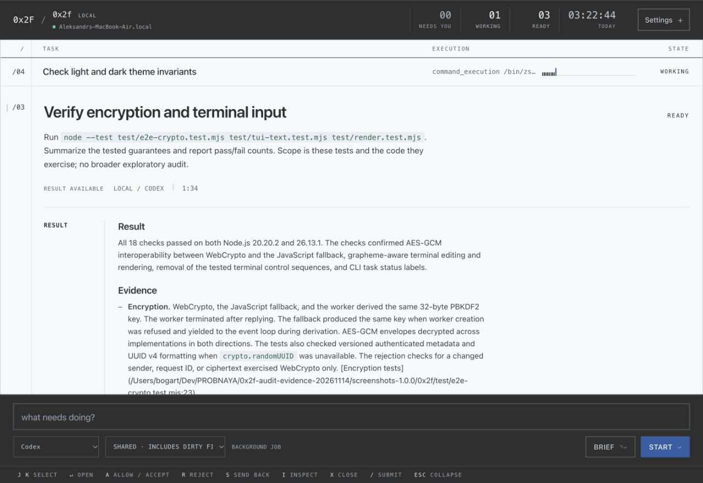
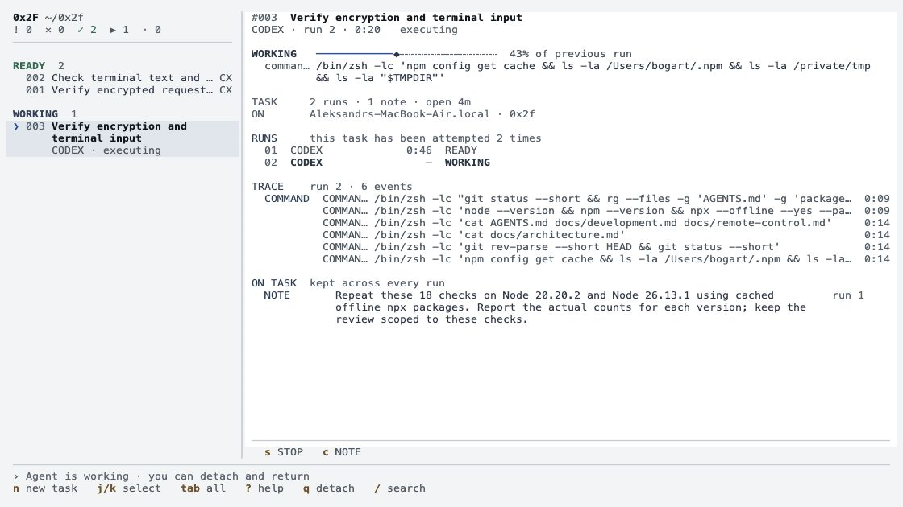
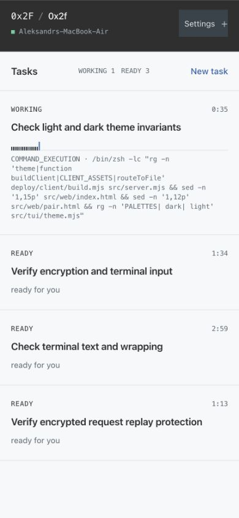

PROBNAYA / 0x2F
INSTRUMENT

Independent Computational Laboratory

# 0x2F

> **1.0.0 — local CLI, TUI and desktop Web.**
> Install the versioned package using [Install](#install).
> Local CLI, TUI and desktop Web are the release scope on macOS and Linux.
> Phone companion and self-hosted remote access remain experimental.
> [Release changes, support and qualification](docs/releases/1.0.0.md).

0x2F is a local work router for coding agents. Give it engineering work —
"Inspect why retries restart the whole run" — and it routes the task to a
coding harness on your machine, runs it in the background, and tracks it
through the lifecycle until you close it. **You work in terms of tasks, not
agent sessions.**

`0x2F` is hex for the ASCII `/` (47). The CLI is `2f`.

Node.js ≥ 20, four direct dependencies (`ws`, `@noble/ciphers`, `@noble/hashes`, `string-width`),
no build step, local-first.

```text
                          0x2F

   Desktop                          Mobile
   2f CLI · Web UI             phone browser
        \                     (remote control,
         \   one task,          via your relay —
          \  many runs           outbound WS)
           \                      /
            └──────────┬─────────┘
                       │
        ┌──────────────┴──────────────┐
        │         Task runtime        │
        │   state · runs · events     │
        │   permissions · decisions   │
        └──────────────┬──────────────┘
                       │  one worker per run
        ┌──────────────┼──────────────┐
        ▼              ▼              ▼              ▼
   claude-code      codex          deepseek-harness   gemini
                        │ any ACP / command agent
        └──────────────┼──────────────┘
                       ▼
              your local project
```

The task is the persistent unit of work. Each run is one disposable agent
session through one harness. 0x2F keeps the task coherent across runs, exposes
what the agent is doing, surfaces decisions when human attention is required,
and lets you intervene — without treating every agent session as a separate
piece of work.

Tasks support cancellation/recovery, isolated worktrees and saved patches, independent checks, bounded continuation receipts, pinned remote-host execution and private backup/restore. Checks and human acceptance remain separate.
[Quickstart](docs/quickstart.md) · [Commands and troubleshooting](docs/usage.md) ·
[Observed harness compatibility](docs/harness-compatibility.md) ·
[Release scope and verification](docs/releases/1.0.0.md) · [Roadmap](docs/roadmap.md).
Supported execution hosts are macOS and Linux/POSIX with Node.js ≥20; the
release qualification covers macOS arm64 and Linux x86_64. Windows
execution and an operated remote execution service are not qualified.
Complete physical mobile browser qualification remains open;
the responsive companion and self-hosted HTTPS path remain experimental.

## Why it exists

Coding harnesses have their own session history and resume capabilities. 0x2F
keeps a separate task record across those harnesses: the original request,
constraints, decisions, run inputs and saved results. Continue the same work
through another supported harness without manually assembling the handoff.

## Install

Requires **Node.js ≥ 20** and at least one coding harness on your PATH:
[Claude Code](https://code.claude.com/docs) (`claude`) is the built-in
default, [Codex](https://github.com/openai/codex) (`codex`),
[DeepSeek Harness](https://github.com/deepseek-ai/DeepSeek-Harness) (`dsh`),
[Gemini CLI](https://github.com/google-gemini/gemini-cli) (`gemini`), and
[OpenCode](https://opencode.ai/) (`opencode`, through ACP)
are also built in, and any ACP-compatible agent or headless executable
can be added per project (see [Providers](#providers)). 0x2F itself is one
small package with WebSocket and cryptography dependencies, no build step,
no accounts. The Web runtime and task workers run as background processes.

Install a supplied release archive into a separate prefix to use one exact
version. This also preserves the previous executable for rollback:

```bash
npm install -g --prefix "$HOME/.local/0x2f-1.0-review" /absolute/path/0x2f-1.0.0.tgz
export PATH="$HOME/.local/0x2f-1.0-review/bin:$PATH"
2f version                       # 1.0.0
```

At the preparation check on 2026-11-15, the public registry served 0.3.0.
The archive above contains the security and interface changes described in
this release. Once 1.0.0 is available in the registry, use
`npm install -g --prefix "$HOME/.local/0x2f-1.0-review" 0x2f@1.0.0`.
Verify `2f version` after either path; [upgrade and rollback](docs/releases/1.0.0.md#install-upgrade-and-rollback)
cover an existing installation.

## Quick start

Inside the repository you want to work on:

```bash
2f init                          # create .work/ with project.md and rules.md
2f new "Investigate why retries restart the whole run"
2f                               # list tasks
2f open 1                        # use the actual ID printed by new
2f tui                           # open the terminal client (full screen)
2f ui                            # open the Web UI (starts the local runtime)
```

Creation immediately prints the persisted ID and its exact reopen command,
for example `Created #014: …` followed by `Open: 2f open 14`. Reopen it from
a separate CLI process; inspect a run with `2f open 14 --run 1`, or continue
the same task with `2f rerun 14 --provider opencode` once its run has ended.
See the [verified Codex → OpenCode example](docs/task-continuity.md).

### Preview a continuation — development branch

This branch adds a [next-run preview](docs/continuation-preview.md), beyond
published 1.0.0. Inspect the exact task input, your recorded instructions and
which prior results are full, excerpted or reference-only before starting.
Local Web continuation opens the preview; TUI `v` and `2f preview <id>` open
it explicitly. If the task or its context changes after review, a guarded
start refuses and asks for a refreshed preview. Draft corrections are saved
only when that reviewed continuation starts.

To run a task with the built-in Codex provider, install the
[Codex CLI](https://github.com/openai/codex), sign in, and select it explicitly:

```bash
codex login
2f providers                     # confirm: codex  native  yes
2f new "Audit the auth flow" --provider codex
```

Codex runs headlessly with workspace-write sandboxing by default and supports
same-thread resume. Its structured-event and permission boundaries are
documented in [`docs/codex-capability-map.md`](docs/codex-capability-map.md).

Codex normally keeps your CLI configuration and authentication. If that
configuration forces a model unavailable to your account, opt in to the
installed CLI default for one invocation:

```bash
CODEX_IGNORE_USER_CONFIG=1 2f new "Investigate a CLI bug" --provider codex
```

This skips the entire Codex user config for that invocation; authentication
still uses Codex’s existing storage. It does not edit settings, force a model,
or retry a failed execution. The same opt-in applies to Codex reruns/resumes.

OpenCode is also built in through `opencode acp`:

```bash
2f providers
2f new "Inspect a CLI bug" --provider opencode
```

Configure an available model in OpenCode itself. Existing workspace OpenCode
manifests retain their explicit command and permission settings.

To run a task with the built-in Gemini CLI provider, install the
[Gemini CLI](https://github.com/google-gemini/gemini-cli), authenticate once
(run `gemini` interactively, or set `GEMINI_API_KEY` / Vertex credentials),
and select it explicitly:

```bash
gemini          # first run: sign in interactively
2f providers    # confirm: gemini  native  yes
2f new "Audit the auth flow" --provider gemini
```

Gemini runs headlessly (`-p --skip-trust -o stream-json`), auto-approves
file edits (`--approval-mode auto_edit`; override with `GEMINI_APPROVAL_MODE`),
and supports same-session resume by UUID. Its structured-event, permission
and resume boundaries are documented in
[`docs/gemini-capability-map.md`](docs/gemini-capability-map.md).

`2f init` creates `.work/` with `project.md`, `rules.md`, `knowledge.md`,
`decisions.md` and `providers/` — edit `project.md` and `rules.md` once;
every task prompt is built from them. It also tells you which provider will
run, or what to install if none is available.

If `2f new` refuses with "Execution provider ... is unavailable", no harness
is on PATH — install one, or configure a provider (see
[Providers](#providers)).

## How a task works

```text
                    ┌────────────────────────────────────┐
                    ▼                                    │
 WORKING ───────────────► READY / FAILED ────────────────┘
    │                                (2f close → DONE)
    │  the agent needs a human
    ▼
 NEEDS YOU
   ├─ PERMISSION  → 2f allow | 2f reject
   │                the same run/session continues
   └─ DECISION    → 2f answer (recorded with the task)
                    rerun the task to continue with it in context
```

A task that hits something the agent cannot decide alone becomes **NEEDS YOU**.
`2f open <id>` (or the Web UI) shows what it is asking for. There are two
distinct interactions:

- **PERMISSION** — a concrete operation needing authorization (an edit, a
  command). `2f allow <id>` / `2f reject <id>` answers it and the same run
  continues.
- **DECISION** — the agent cannot continue without your judgment.
  `2f answer <id> "<your answer>"` records your answer with the task. A
  decision is never allow/rejected.

The decision request is a machine-read protocol, not prose. Agents signal one
by ending with:

```text
## Needs human decision
REQUIRED: yes
QUESTION: <the concrete question a human must answer>
```

Anything else — a bare heading, "None", "No decision required", or any prose —
is treated as **no** decision, so a finished run completes READY instead of
interrupting you for work that did not need you.

`2f close <id>` (or **CLOSE** in the Web UI) removes any task from active
attention — a wrong NEEDS YOU, a non-resumable one, a FAILED or READY run you
no longer want. It never resumes the provider and never starts a new
execution.

Closing does not cancel an active provider. Let an active run finish before
closing it; a later permission request on a closed task can otherwise leave
the provider waiting. If a local POSIX worker crashes but its execution
processes survive, rerun refuses until that previous process group exits.

## One task, many runs


<picture>
  <source media="(prefers-color-scheme: dark)" srcset="https://raw.githubusercontent.com/probnaya-work/0x2f/v1.0.0/docs/images/1.0.0/web-dark.jpg">
  
</picture>

Real Codex release-review tasks. The result records 18 passing checks on each
of Node 20 and 26; the activity lane shows events from the running theme check.
Images follow your light or dark preference.

Every execution is recorded as a **run** under the task, so the same task can
be run again — through a different harness, for comparison:

```text
Task  "Investigate why retries restart the whole run"
  ├── run 01 · claude-code         a fresh session
  ├── run 02 · deepseek-harness    a fresh session
  └── run 03 · claude-code         a fresh session, with your notes
                                   and prior results in context
```

```bash
2f rerun 1 --provider deepseek-harness   # run 02 under task #1
2f open 1 --run 2                        # one run's factual detail
```

A new run is a **continuation of the task, not a blank attempt**: its input
(`runs/<n>/prompt.md`) is rebuilt from current task state — the original
request plus your constraints/answers and prior runs' results, verification
and changed files — and handed to a fresh provider session. The task is
persistent; provider sessions are disposable. Add a constraint with
`2f note <id> "<constraint>"` (or `2f answer` on a decision block); it becomes
part of the next run's context, with no manual copying. The original
`prompt.md` is never overwritten.

## The terminal client

`2f tui` is the full-screen surface: the whole ledger on the left, the
selected task in full on the right, and — pinned to the bottom of the detail
pane — the one action that task is waiting for.

<picture>
  <source media="(prefers-color-scheme: dark)" srcset="https://raw.githubusercontent.com/probnaya-work/0x2f/v1.0.0/docs/images/1.0.0/tui-dark.jpg">
  
</picture>

Captured from the installed TUI on a real 140 × 42 PTY with Codex. The 43%
readout compares elapsed time with this task’s previous run; it is an estimate,
not proof of completion. Terminal cells are rendered with the application
palette; this is not a native terminal font screenshot.

```bash
2f tui                     # or: 2f tui --light
```

It is a client, not a second runtime. It builds the same runtime every other
command builds, calls the same shared actions, and tails the same event logs
the Web server tails — so a run finishing in the background, a `2f allow`
typed in another terminal and a tap on your phone all land in it live, and
anything you do in it lands everywhere else.

The keymap is the surface's own, not a file manager's:

| key | what it does |
| --- | --- |
| `j` `k` | move between tasks (`g` / `G` jump to first / last) |
| `J` `K` | scroll the task detail |
| `tab` | filter — all · needs you · failed · ready · working |
| `/` | search by title, brief or number |
| `↵` | the one action this task is waiting for (shown bottom-left) |
| `x` | the alternative — reject · save only · send back · drop |
| `d` | inspect the saved run patch; legacy tasks use the current working-tree diff |
| `r` | read the full request, saved result and reported checks; `[` / `]` selects a run, `i` reads its saved input, `j` / `k` scrolls, `g` / `G` jumps to either end, `esc` returns |
| `c` | note or correct — kept on the task, carried into every later run |
| `p` | point the next run at another provider |
| `t` | expand the trace of the current run |
| `n` | new task (`⇧↵` inserts a newline, `⌥↵` expands your note into a brief, `↵` starts it) |
| `?` | the key list · `q` detaches — runs keep executing without you |

`↵` is deliberately not "open": on a permission it ALLOWS, on a decision it is
ANSWER & CONTINUE, on a READY task it ACCEPTS, on a FAILED one it RETRIES. The
alternative under `x` is the other half of the same pair. Both go through the
shared actions, so the TUI can never allow something the CLI would refuse.

READY means a result is available for review. `r` reads the provider's saved
Evidence/Verification and their limitations, including investigations with no
file changes. Provider-reported checks and observed command invocations are
distinct from a separately recorded successful check receipt. `d` shows the
immutable observed run patch where available. Legacy tasks use the current
working-tree diff, which may include later edits.

Notes are saved for the next run; they do not steer an already-running worker.
On a phone, shortened commands, hidden edit parameters and ambiguous targets
may require review on the computer. Incomplete remote scope disables ALLOW
and the host also refuses that grant; REJECT and local inspection remain
available. A completed worker's short-lived descendants get a bounded drain
interval before retry; a still-existing execution group continues to block it.

## Desktop + mobile

The CLI, the TUI and the Web are three surfaces over the same core:

```bash
2f ui                      # or: 2f ui <port>, 2f ui --no-browser
```

`2f ui` behaves like opening a local application: if a 0x2F runtime is already
healthy for this workspace on `http://127.0.0.1:4242` (localhost only) it
reuses it; otherwise it starts the runtime in the background, waits until it is healthy, and opens the
UI. Runtime output lands in `.work/ui.log`. The browser calls the same shared
actions over a local HTTP/SSE API and subscribes to the same normalized
events.

If that port serves another workspace, use `2f ui <port>` to open this one on
a different port.

Control 0x2F from your phone on the **same Wi-Fi** — the Mac keeps running
the work; the phone is a compact control surface:

<picture>
  <source media="(prefers-color-scheme: dark)" srcset="https://raw.githubusercontent.com/probnaya-work/0x2f/v1.0.0/docs/images/1.0.0/mobile-dark.jpg">
  
</picture>

Responsive 390 × 844 browser capture of the same real Codex tasks, with a live
activity lane. Physical-device qualification is recorded separately.


```bash
2f pair
```

No flags, no IPs to find, no relay to configure. `2f pair` detects the Mac's
private LAN address, enables the pairing surface on that interface (and only
while pairing is active), and prints a phone-openable URL **plus a one-time
pairing code**:

```
0x2F PAIR

same Wi-Fi required

  http://192.168.1.163:4242/pair?relay=…&token=…&device=…

code  ZEPQQ-N4WH8-NG4D
```

Open the URL on your phone and type the code into the trusted page (served by
the Mac itself). The phone then speaks the same Web UI against the Mac: see
NEEDS YOU / WORKING / READY / FAILED, open a task, and ANSWER / ALLOW /
REJECT / NOTE / SEND BACK / ACCEPT. Every command, ack, event and snapshot is
end-to-end encrypted (AES-256-GCM keyed by the pairing code) — the same
encrypted channel the hosted relay uses, so a passive observer on the Wi-Fi
sees only ciphertext. While the Mac is offline the phone shows its own
last-known state with a **MAC OFFLINE** banner and disables actions; commands
are never queued, and a retried command reuses its `requestId` so it can
never execute twice.

Pairing tokens are one-time and expire in 10 minutes; phone sessions live 30
days and are revoked by `2f pair --off` (a real revocation — the LAN surface
closes within a second, and normal `2f` / `2f ui` stay loopback-only the whole
time) or by re-pairing, which also rotates the Mac's credential and the E2E
key. The LAN surface serves only the pairing client + relay protocol on
private-LAN addresses (RFC 1918) — the normal local API is never reachable
from other devices on the network.

For **remote control away from the LAN** (future use, or your own
deployment), use `2f pair --relay https://… --client https://…`. Supply both
operator-owned origins (or both legacy env vars via `env`; see
[`deploy/README.md`](deploy/README.md)). No hosted service address is filled in
automatically. The hosted relay is
**private infrastructure, not part of the local product**: a small standalone
app that forwards encrypted envelopes, holds no task state, and is never
shipped in the npm package. Deployment details live in
[`relay/README.md`](https://github.com/probnaya-work/0x2f/blob/main/relay/README.md);
a full setup-and-test walkthrough is in
[`docs/remote-control.md`](https://github.com/probnaya-work/0x2f/blob/main/docs/remote-control.md).

## Where your work lives

Everything 0x2F knows about a project lives in `.work/` inside that
repository — nothing is stored globally, and nothing leaves your machine
unless you opt into remote pairing:

| What | Where |
| --- | --- |
| task state + run history | `.work/tasks/<slug>/` |
| project context every prompt is built from | `project.md` · `rules.md` · `knowledge.md` · `decisions.md` |
| routing policy (optional — you author it; `2f init` does not create it) | `.work/routing.json` |
| extra providers | `.work/providers/*.json` |
| UI runtime log | `.work/ui.log` |
| pairing credentials (only if you pair) | `.work/relay.json` |

Before deleting `.work/`, stop its runtime and workers and preserve any results
or isolated task changes you need. Isolated checkouts live inside `.work/`:
deleting it also deletes their unapplied work. Apply or privately back up that
work first. Uninstalling the npm package leaves project state in place.

## Updating and uninstalling

For an archive installation, install the next versioned archive into a fresh
prefix and follow the [upgrade procedure](docs/releases/1.0.0.md#install-upgrade-and-rollback).
Registry update commands select the earlier public version until publication.
Remove the review installation explicitly from its own prefix:

```bash
npm uninstall -g --prefix "$HOME/.local/0x2f-1.0-review" 0x2f
```

Project `.work/` state survives uninstalls — it belongs to the project, not
to the install.

## Providers

0x2F has three provider integration paths behind one contract:

| Integration | What it is | Use |
| --- | --- | --- |
| **Native** | Deep adapter for one harness's specific capabilities | `claude-code` (permissions → `needs_you` → same-session resume), `codex` (structured exec events + thread resume), `deepseek-harness`, `gemini` (structured stream events + UUID session resume) |
| **ACP** | One generic provider speaking the [Agent Client Protocol](https://agentclientprotocol.com) v1 over stdio | Built-in OpenCode; any other ACP-compatible agent configured by manifest |
| **Command** | One generic provider for headless executables | Any CLI that takes a prompt and prints a result — configured by manifest |

`claude-code`, `codex`, `deepseek-harness`, `gemini`, and `opencode` are built in.
Everything else is added **declaratively**: drop one JSON manifest into
`.work/providers/` and it becomes a provider — no source changes:

```json
{
  "id": "cursor",
  "displayName": "Cursor",
  "transport": "acp",
  "command": ["agent", "acp"]
}
```

ACP manifests may set `"permissions"`: `"interactive"` (default — a permission
request pauses the run and asks you), `"deny"`, or `"approve"` (headless
auto-resolution). Command manifests must pass the task through the `{prompt}`
placeholder. Commands are spawned as argv arrays, never through a shell.
Vendor-documented example manifests live in [`examples/providers/`](https://github.com/probnaya-work/0x2f/blob/main/examples/providers/README.md);
`2f providers` lists every provider with its integration type and availability.
Availability is separate from authenticated execution and scenario qualification;
see the [observed compatibility matrix](docs/harness-compatibility.md), including
the real Codex → Cursor → Codex task handoff and separately retained setup preflights.

By default `2f new` uses the configured routing default. When it is `auto`,
0x2F picks the harness deterministically: available providers first, then the
ids listed in `.work/routing.json` in order, then registry order. It does not
read the task text and never claims a provider is "best" — the decision is
persisted with the run and shown by `2f open` / the Web UI. Override any time:

```bash
2f new "Audit the auth flow" --provider auto        # deterministic routing
2f new "Audit the auth flow" --provider claude-code # explicit
```

```json
// .work/routing.json
{
  "default": "auto",                       // "auto" or a provider id
  "prefer": ["claude-code", "deepseek-harness"]
}
```

`routing.json` is optional and hand-authored. `2f init` does not create it,
and `2f new` runs fine without it — the routing default (or an explicit
`--provider`) applies until you write the file yourself. No command edits it;
edit the JSON directly if you want non-default routing policy.

## Architecture

```text
CLI · TUI · Web · phone
    │   shared actions + normalized events
    ▼
Work Core          lifecycle · actions · runs · events · store
    │
    ▼
Router             AUTO: availability + routing config (deterministic)
    │
    ▼
Execution node     local machine (spawns the detached worker)
    │
    ▼
Provider           native · ACP · command
    │
    ▼
Coding harness     claude-code · codex · dsh · gemini · opencode · cursor · any command
```

No surface implements lifecycle or provider logic — the CLI, the terminal
client (`src/tui/`) and the browser all call the same shared actions (`src/core/actions.mjs`) and read the same
normalized events (`src/core/events.mjs`). Everything a task needs persists
under `.work/` in the repository you run 0x2F in: task state and run history
(`.work/tasks/<slug>/`), the project context every prompt is built from
(`project.md`, `rules.md`, `knowledge.md`, `decisions.md`), routing
(`routing.json`), and configured providers (`providers/*.json`).

Three distinctions that help read the code:

- **Task ≠ provider session.** A task persists; a session is metadata under
  one of its runs.
- **Provider ≠ execution node.** A harness runs on a machine; the node owns
  where execution happens (only `local` today).
- **Provider ≠ model.** A harness runs many models; 0x2F routes to harnesses.

```text
YOUR MACHINE                          PRIVATE INFRASTRUCTURE (yours)
─────────────                         ─────────────────────────────
local project       ◄── outbound ──►  relay (optional, for mobile)
agent processes          WebSocket    · pairing + forwarding only
task runtime                           · no task state, no credentials
desktop UI
```

Execution stays on the selected runtime's host. The API binds to
`127.0.0.1` by default, is token-authenticated and refuses cross-site browser
requests. Explicit `2f on <host> ...` profiles invoke that host's own CLI over
pinned SSH; they do not migrate tasks or provider credentials. Phone control
uses the optional relay or the explicitly enabled LAN pairing surface.

## Current limitations

- **Execution belongs to its host runtime.** [A persistent Linux host](docs/host-setup.md)
  runs its own runtime and workspaces. `2f on` is explicit SSH CLI dispatch;
  there is no automatic task migration, credential transfer or host failover.
- **Remote control has limits.** No push notifications (the phone works while the
  app is open), no offline command queue by design; one phone at a time per
  Mac (re-pairing revokes the previous phone's session).
- **AUTO is deterministic policy routing**, not semantic selection — and there
  is no automatic failover (a routed run that fails is `failed`, not secretly
  retried elsewhere).
- **Runs of one task are strictly sequential.** No concurrent or
  multi-agent orchestration of a single task.
- **No evaluation.** Run history is for inspection — no scores, no winners,
  no recommendations.

057 has an external, read-only adapter for `.work/tasks` and an opt-in
MACHINE PULSE SSH source for aggregate Linux activity. Its signed Display
consumes the same Core Landscape; see the [host setup](docs/host-setup.md) and
release evidence for observed device behavior and limits.
See the [roadmap and actual hosting status](docs/roadmap.md).

## Development

Install the dependencies once; there is no build step:

```bash
npm install       # ws, @noble/ciphers, @noble/hashes, string-width
npm test          # the test suite (node --test, including real PTY regression)
npm run check     # syntax-check every source and test file
npm start         # run the CLI: node src/cli.mjs
```

See [`docs/development.md`](https://github.com/probnaya-work/0x2f/blob/main/docs/development.md)
for the repository layout and how the pieces fit;
[`docs/architecture.md`](https://github.com/probnaya-work/0x2f/blob/main/docs/architecture.md)
traces a task through the whole system.

## License

[MIT](LICENSE)

## Upgrade from previous releases

Quiesce old workers and other workspace writers before changing the executable.
Keep the old prefix and a consistent private backup of the workspace and state.
Use the matching executable to inspect/export/apply its isolated
tasks; an old 0.2.0 executable must not execute them against the original checkout. Restore
uses a new directory and disables credentials, host profiles and execution
authority; it never replays a run. Review before configuring trust again.
See [release upgrade/rollback](docs/releases/1.0.0.md#install-upgrade-and-rollback).
