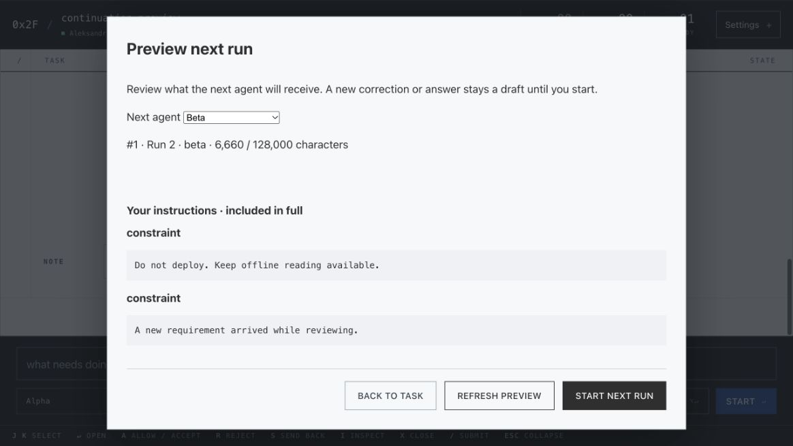

# Preview the next run

Available in **1.1.0**. [Release scope and qualification](releases/1.1.0.md).

Review the task input before continuing through the same or another agent.
The preview includes the original request, recorded instructions, current
project context, prior outcomes and the exact text the next fresh session
will receive. Previous results are labelled **included in full**, **excerpt**
or **reference only** according to the existing context budget. Binding user
instructions are not shortened. A context-budget overflow refuses the preview.

## Web

In the local Web UI, SEND BACK, retry and ANSWER & CONTINUE open a preview
before starting. Select the next agent, inspect your instructions and prior
result delivery, then expand **Exact next run input** to read the whole task
prompt. **START NEXT RUN** starts explicitly. **BACK TO TASK** or Escape
returns without a run; a new correction or answer remains an editable draft.
Use the task's existing input to edit it and open the preview again.

The preview stays mounted while the ledger updates. Refreshing it reads the
current context. It does not start an agent, create a run, save a draft,
create an isolated checkout or write future-run artifacts.



Screenshot from the real local UI with deterministic test agents; it is not
a live-model performance claim.

## TUI

- `v`: preview the selected task's next run; `p` on the task selects its next agent.
- `Enter` while entering SEND BACK or ANSWER & CONTINUE: preview with the
  unsaved correction or answer. Escape returns to the editable draft.
- In the preview, arrows or `j/k`, PgUp/PgDn and `g/G` scroll; `u` refreshes;
  Enter starts the reviewed continuation; Escape returns without starting.

RETRY and REOPEN also open the preview before starting. SAVE ONLY and notes
still save without starting a run. `Alt+Enter` in the correction/answer editor
remains an alias for preview. This does not replace the saved-run reader
(`r`, then `i`), which inspects an already executed run.

## CLI

```bash
2f preview 14 --provider opencode
```

Use the actual task ID. This prints the exact next task input, delivery
labels and a command containing a preview ID. Run the printed command when
ready, for example:

```bash
2f rerun 14 --provider opencode --preview <preview-id>
```

The existing `2f rerun` command without `--preview` still starts directly.
The terminal neutralizes control sequences for display; the saved input
preserves its original bytes.

## Freshness and scope

A reviewed start rechecks the task, resolved target, recorded instructions,
project-context revision, prior results and budget under the task lock. A
mismatch refuses before a new run or draft is persisted. On a match, the
same prepared prompt and context receipts are saved for execution. Two
concurrent starts cannot replay the reviewed run.

The preview ID is a freshness check, not an authorization credential. Normal
authentication, provider availability, execution admission and sequential-run
guards still apply. There are no automatic launch retries. If a launch response
is lost, inspect the authoritative task before attempting another run. Web
requests time out after 30 seconds; timeout does not prove the server refused
the start. Authoritative task state clears only the exact consumed draft,
preserving a newer edit. A failed TUI start likewise checks whether its draft
was already saved. Confirmation stays disabled until a successful refresh.
Refreshing an open preview cannot silently advance it to a different run:
return to the task to review a later attempt.

This is the exact task prompt, not a capture of every input to the model.
Harness configuration, its own system instructions and files it reads remain
part of that harness. A continuation starts a fresh session; hidden provider
state and full transcripts are not transplanted. The preview does not freeze
working-tree files or guarantee that an agent will follow the instructions.

Full input is available locally through CLI, TUI and authenticated local Web.
The experimental phone/relay protocol retains its existing minimized data
and continuation controls; full prompts are not added to it.

## Local API

Authenticated `POST /api/tasks/:id/preview` accepts `provider`, `model` and an
optional draft `input: {kind: "correction" | "answer", text}`. It returns the
prompt, context receipt, user inputs, preview ID and normalized `options`.
POST those returned options plus `previewId` to `/api/tasks/:id/rerun` to
start the reviewed continuation. Preserve the returned draft timestamp when
submitting; do not reconstruct the options from the displayed prose.

Preview and guarded start use the same read-only compiler. Run/task storage
layout is unchanged, and upgrading does not migrate existing task data.
