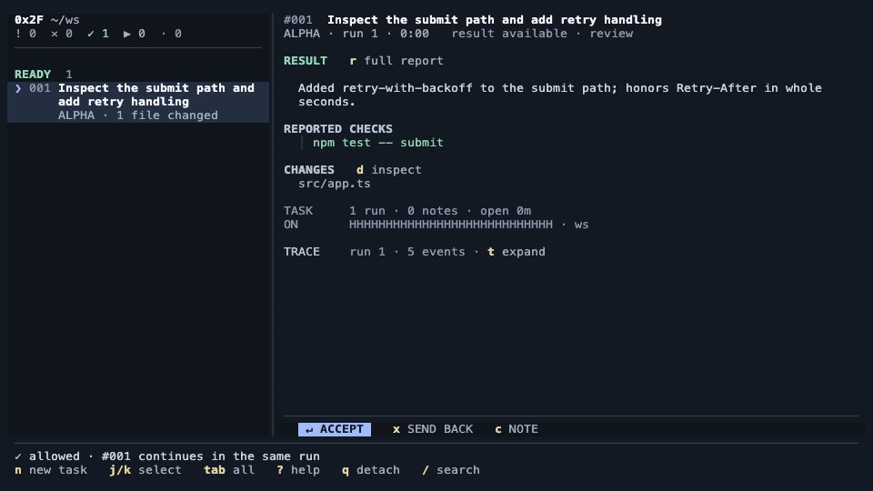
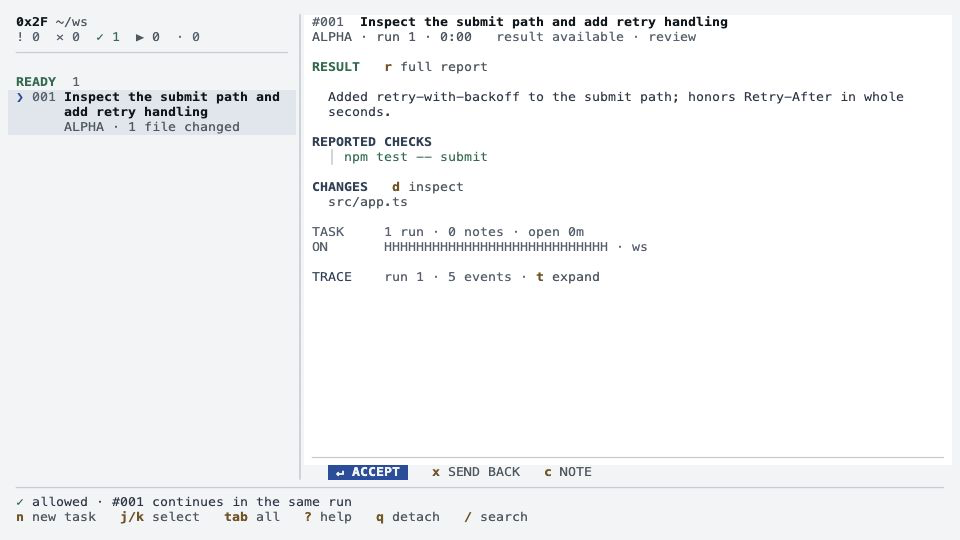
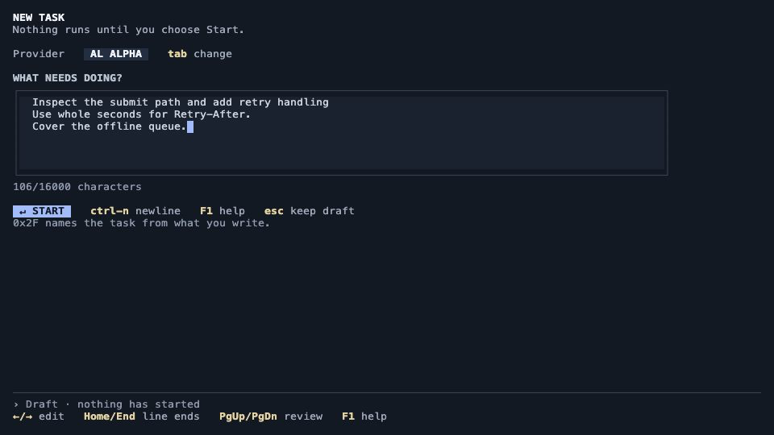
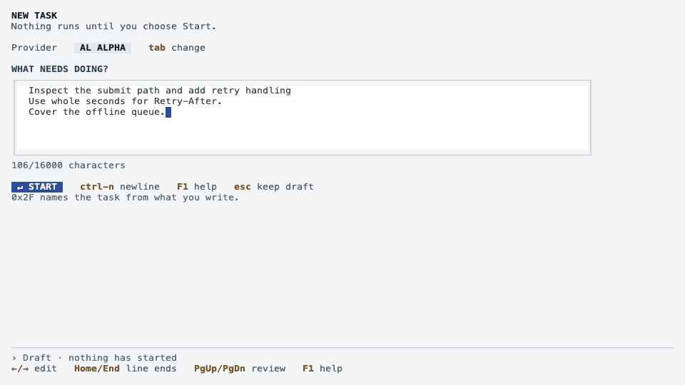

# Final TUI screenshots — 2026-11-15

Candidate **0.3.1-rc.8**. Matching states in both themes, each 960×540. These PNGs are browser screenshots of the actual installed-package PTY captures with normalized clocks and hostname. They do not claim inspection of native Terminal fonts. [Verification](tui-design-qualification-2026-11-15.md), [capture manifest](0.3.1-rc.8-evidence/screenshots.json).

## Result — dark

## Result — light

## New task — dark

## New task — light

## Next release boundary

The terminal design and current candidate checks are complete. This is not a public 1.0.0 qualification. The remaining exact-artifact physical phone and operated HTTPS checks, or explicit scope exclusions, remain in the [qualification record](public-release-qualification-2026-11-14.md#physical-evidence-and-remaining-release-gates). Approval of these screenshots can lead into 1.0.0 preparation; version changes, final package installation and release qualification must precede publication.
